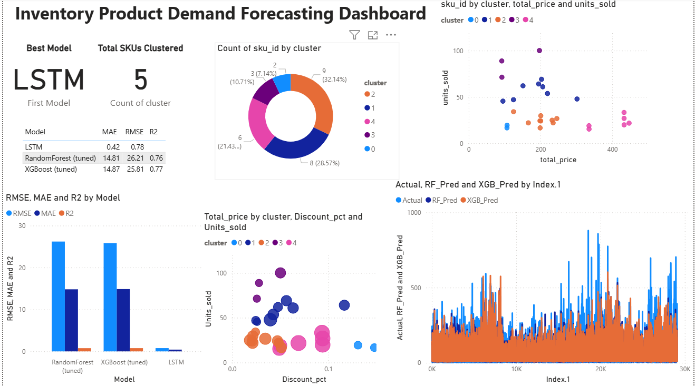

# 🧠 Demand Forecasting ML Project

## 📌 Overview
This project predicts **product demand** using Machine Learning (Random Forest, XGBoost, and LSTM) and visualizes key insights with a **Power BI Dashboard**.  
The dataset contains historical sales transactions including date, product, quantity, and customer details.

---

## 🧾 Dataset
- **Data:** [`data.csv`](./data/data.csv)
- **Attributes:** TransactionNo, Date, ProductNo, ProductName, Price, Quantity, CustomerNo, Country

---

## 🧩 Machine Learning Models
| Model | RMSE | MAE | R2 | Key Highlights |
|-------|------|-----|----|----------------|
| Random Forest | *26.207318* | *14.811426* | *0.763532* | Baseline ensemble model |
| XGBoost | *25.813978* | *14.867461* | *0.770576* | Optimized boosting performance |
| LSTM | *61.107594* | *32.383543* | *0.480539* | Sequential deep learning model for time series |

---

## 📊 Power BI Dashboard
The Power BI dashboard summarizes:
- 📈 Actual vs Predicted Demand Comparison  
- 🕒 Monthly Trends  
- 🏷️ Product-level Performance  
- 🌍 Country-wise Sales Distribution  

📂 **File:** [`demand_powerBI_Dashboard_project.pbix`](./demand_powerBI_Dashboard_project.pbix)

---

## 📓 Notebook
All data cleaning, feature engineering, model training, and evaluation steps are detailed in:  
📘 [`demand_pred_ML_JNfile.ipynb`](./demand_pred_ML_JNfile.ipynb)

---

## 📁 Outputs
| File | Description |
|------|--------------|
| `actu_vs_pred.csv` | Actual vs Predicted comparison data (used in Power BI) |

---

## 🚀 Tools & Technologies
- **Python:** pandas, scikit-learn, xgboost, keras, matplotlib, seaborn  
- **Power BI:** Dashboard design & visualization  
- **Jupyter Notebook:** Model development environment  

## 📢 Results Summary
- LSTM gave the best predictive accuracy overall.
- Power BI dashboard gives a complete business overview in one page.

---

